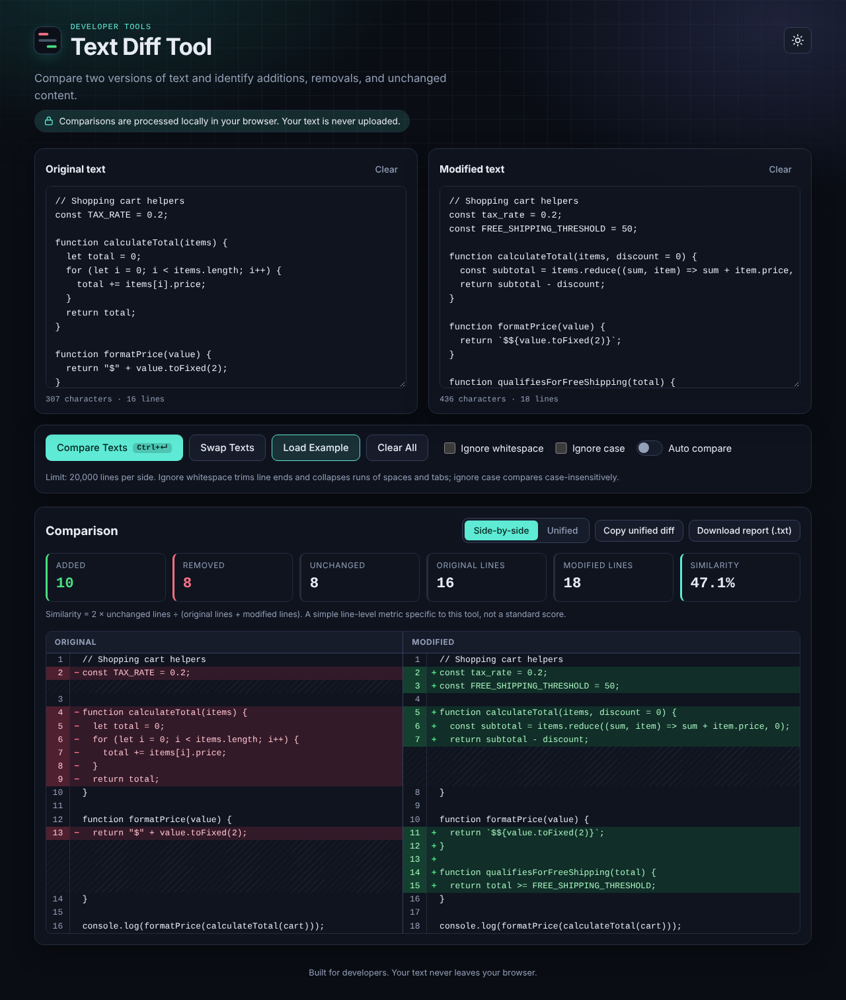
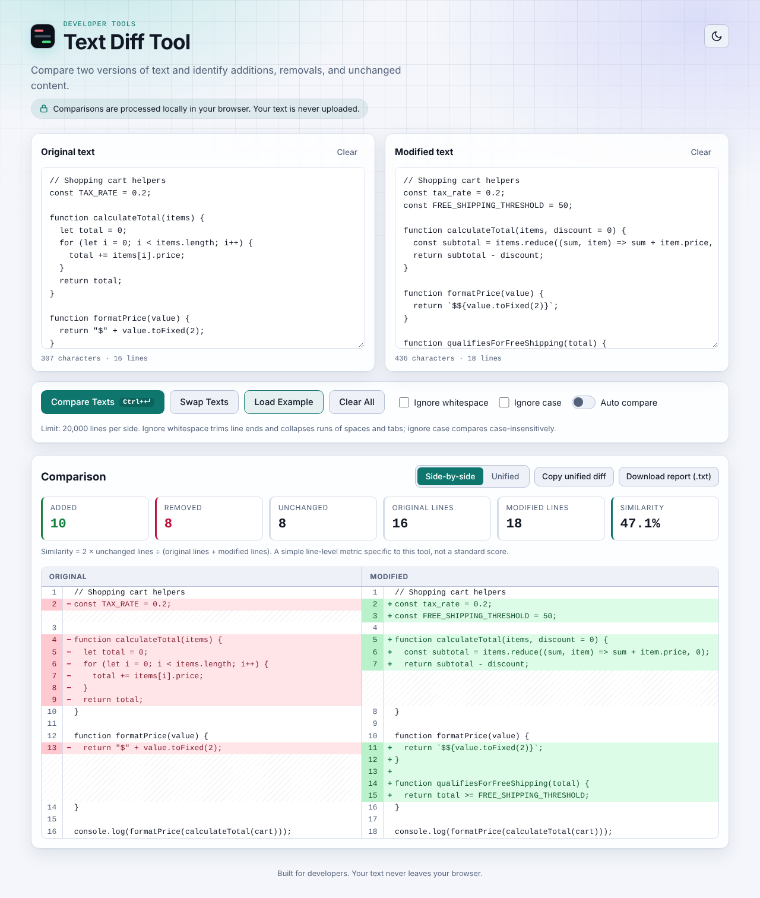
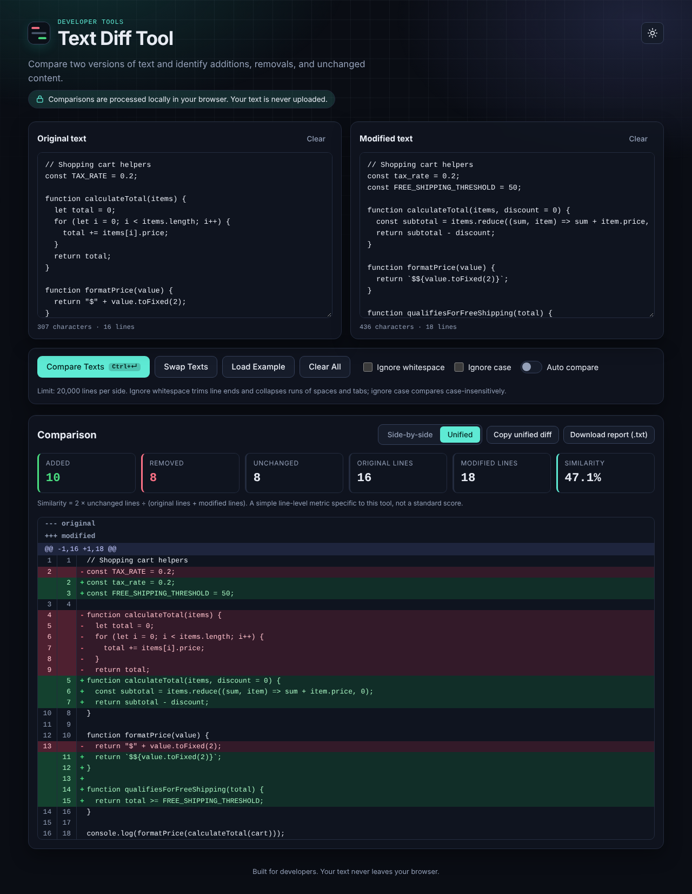
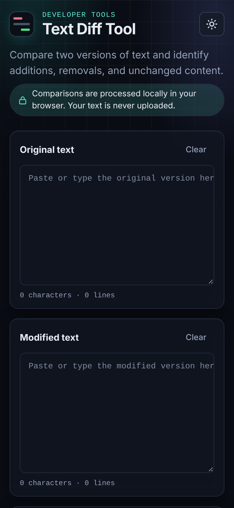

# Text Diff Tool

A fast, private, browser-based tool that compares two blocks of text and highlights added, removed and unchanged lines. Built with vanilla HTML, CSS and JavaScript ES modules: no framework, no backend, no build step.

**Live demo:** `https://YOUR-USERNAME.github.io/text-diff-tool/` *(placeholder: replace after deploying)*

## Features

- Real line-based diff using **Myers' O(ND) algorithm** (the family of algorithms behind `git diff`), which produces a minimal edit script
- **Side-by-side** view with line numbers, aligned change blocks and `+` / `−` markers (never colour alone); long unchanged runs fold into an expandable row
- **Unified** view with `---`/`+++` headers, `@@` hunk headers (3 lines of context) and old/new line numbers
- Statistics: added, removed, unchanged, original and modified line counts, similarity %
- Options: **Ignore whitespace**, **Ignore case**, **Auto compare** (debounced, off by default)
- Swap, per-panel Clear, Clear All, Load Example
- Copy the unified diff (plain text) and download a `.txt` report
- `Ctrl+Enter` / `Cmd+Enter` compares from anywhere
- Dark and light themes: follows the OS on first visit, manual toggle, choice saved in `localStorage`
- Accessible: semantic HTML, labelled controls, visible focus, live-region announcements, reduced-motion support
- Private: Content-Security-Policy with `connect-src 'none'` and no inline scripts; text rendered only via `textContent`

## Screenshots

| Dark, side-by-side | Light, side-by-side |
| --- | --- |
|  |  |

| Dark, unified | Mobile (dark) |
| --- | --- |
|  |  |

## Technology

HTML5, CSS3, vanilla JavaScript (ES modules). Dev-only: [Vitest](https://vitest.dev) with `@vitest/coverage-v8`, GitHub Actions, GitHub Pages. There are no runtime dependencies.

## Project structure

```
text-diff-tool/
├── index.html                 Page structure, metadata, CSP
├── src/
│   ├── css/styles.css         Design tokens, themes, layout, diff views
│   └── js/
│       ├── bootstrap.js       Classic script: theme before first paint, startup-error notice
│       ├── main.js            State, events, coordination
│       ├── diff.js            Pure diff engine + unified-diff builder (no DOM)
│       ├── render.js          Safe DOM rendering of both views and the stats
│       ├── stats.js           Statistics and similarity
│       └── utils.js           Counters, debounce, clipboard, download, report
├── tests/
│   ├── diff.test.js           Diff engine, unified output, statistics
│   └── utils.test.js          Helpers and report
├── assets/favicon.svg
├── docs/screenshots/
├── .github/workflows/tests.yml
├── vitest.config.js
├── package.json
├── .gitignore
├── README.md
└── LICENSE
```

Two small additions to the requested structure: `bootstrap.js` must run as a classic script before first paint (no theme flash) and lives in a file so the CSP can forbid inline scripts; `vitest.config.js` holds the coverage settings.

## Local development

The app uses ES modules, which browsers **refuse to load from `file://`**. Serve the folder over HTTP:

```bash
python3 -m http.server 8080      # or: npx serve .
# open http://localhost:8080
```

If you open `index.html` straight from disk, the page shows a notice explaining this instead of failing silently.

### Install dev dependencies (first time)

```bash
npm install        # creates package-lock.json: commit it, CI uses `npm ci`
```

## Tests

```bash
npm test               # run once
npm run test:watch     # watch mode
npm run test:coverage  # coverage for diff.js, stats.js, utils.js (text + HTML report in coverage/)
```

The suites cover identical / different / empty inputs, added / deleted / modified lines, blank and repeated lines, Unicode, CRLF vs LF, trailing newlines, both ignore options, counts, similarity, large inputs, HTML-like strings, the line limit, hunk building, and a randomised test that checks every result is lossless **and minimal** by comparing against a dynamic-programming LCS. `render.js` and `main.js` are DOM code and are not unit tested.

## How the diff works

1. **Split** both texts into lines (`\r\n`, `\n` and `\r` are equivalent). A final terminator is recorded as `endsWithNewline`; it does not create an extra empty line. `""` has zero lines, `"\n"` has one blank line.
2. **Comparison keys:** each line is normalised according to the options, then interned to an integer, so the inner loop compares numbers. The displayed text is never altered.
3. **Trim** the common prefix and suffix; they are unchanged by definition and are the common case for "small edit in a big file".
4. **Myers' greedy algorithm** finds a shortest edit script for the remainder: a path through the edit graph where a right step deletes a line, a down step inserts one, and diagonals (equal lines) are free. The furthest-reaching point on each diagonal is snapshotted per edit count so the path can be walked back. It works on positions, so repeated lines are classified correctly.
5. In each run of changes, deletions are listed before insertions. Side-by-side pairs them row by row; unified groups operations into hunks. **Both views and the copy/download output are built from the same operation list.**

**Complexity** (N, M = line counts, D = added + removed lines in the changed region): time O((N+M)·D); space O(D²) for the snapshots plus O(N+M) for keys. A classic LCS table needs O(N·M).

### Ignore options

- **Ignore whitespace:** each line's key has leading and trailing whitespace trimmed and every internal run of whitespace (spaces, tabs, Unicode spaces) collapsed to one space. `a   b` equals ` a b `, but `ab` differs from `a b`. Blank and whitespace-only lines are still lines. A trailing-newline-only difference is ignored in this mode.
- **Ignore case:** keys are lower-cased.
- Both can be combined. In every case the original text is what is displayed. For lines that match only because of an ignored difference, the side-by-side view shows each side's own text; unified context lines show the modified text.
- Line endings (CRLF / LF / CR) are always treated as equivalent. If only the trailing newline differs, the unified output ends with a `\ … has no newline at end of file` note.

### Statistics

| Statistic | Meaning |
| --- | --- |
| Added | Lines only in the modified text |
| Removed | Lines only in the original text |
| Unchanged | Lines matched in both texts (counted once) |
| Original / Modified lines | Total lines in each input |

**Similarity = 2 × unchanged ÷ (original lines + modified lines) × 100**, rounded to 0.1. This is a project-specific, line-level measure (the same shape as a Dice coefficient), not an industry-standard score. A changed line counts as one removal plus one addition. Two empty texts count as 100 %.

## Security and privacy

- No network requests: no backend, analytics or third-party code, and the CSP (`default-src 'none'`, `script-src 'self'`, `connect-src 'none'`) enforces this in supporting browsers.
- User text is rendered only through `textContent`; `innerHTML` and friends are not used anywhere. Strings such as `<script>` are shown literally.
- User text is never logged. Only the theme preference is stored (`localStorage`).
- Copy (Clipboard API with a fallback) and download (Blob URL) happen locally; failures show a clear message.

## Limits and known limitations

- **20,000 lines per side.** Larger inputs are rejected with a message; nothing is silently truncated. The constant is `MAX_LINES_PER_SIDE` in `src/js/diff.js`.
- **Edit distance cap of 2,000** changed lines in the region that remains after trimming the common prefix and suffix (this bounds snapshot memory to roughly 16 MB). Beyond that the app shows the region as fully replaced and displays a notice that the result is valid but not minimal (`MAX_EDIT_DISTANCE`). A pure insertion or deletion of any size is not affected.
- The comparison runs on the main thread. Inputs over ~100,000 characters show a "comparing" state first, but extreme cases can still pause the page briefly.
- Line-based only: no word-level or intra-line highlighting.
- Side-by-side folds runs of more than 12 unchanged lines (keeping 3 lines of context around changes) so very large, mostly-equal files stay fast; each fold has a button to expand it.
- Line numbers and markers are not part of selected/copied text from the on-screen views; use **Copy unified diff** for the full diff.

## Deploy to GitHub Pages

1. Create a GitHub repository and push this folder to `main`.
2. **Settings → Pages → Build and deployment → Deploy from a branch**, branch `main`, folder `/ (root)`.
3. Open `https://<user>.github.io/<repo>/`. All paths are relative, so project URLs work, and GitHub Pages serves `.js` with a JavaScript MIME type, which ES modules require. No build step is needed.

## Continuous integration

`.github/workflows/tests.yml` runs on every push and pull request: `npm ci`, `npm test`, then coverage, on Node 22. It needs a committed `package-lock.json` (see *Install dev dependencies*). Check the repository's Actions tab for the real status.

